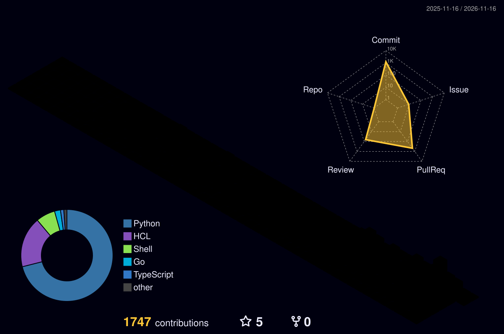

## ⚡ Toolbox

 
 
 

## 🏆 Highlights

 

## 📊 GitHub in Motion

<picture>
  <source media="(prefers-color-scheme: dark)" srcset="https://raw.githubusercontent.com/amansquadstack/amansquadstack/main/profile-3d-contrib/profile-night-rainbow.svg" />
  <source media="(prefers-color-scheme: light)" srcset="https://raw.githubusercontent.com/amansquadstack/amansquadstack/main/profile-3d-contrib/profile-season-animate.svg" />
  
</picture>

  

<picture>
  <source media="(prefers-color-scheme: dark)" srcset="https://raw.githubusercontent.com/amansquadstack/amansquadstack/output/github-contribution-grid-snake-dark.svg" />
  <source media="(prefers-color-scheme: light)" srcset="https://raw.githubusercontent.com/amansquadstack/amansquadstack/output/github-contribution-grid-snake.svg" />
  
</picture>

